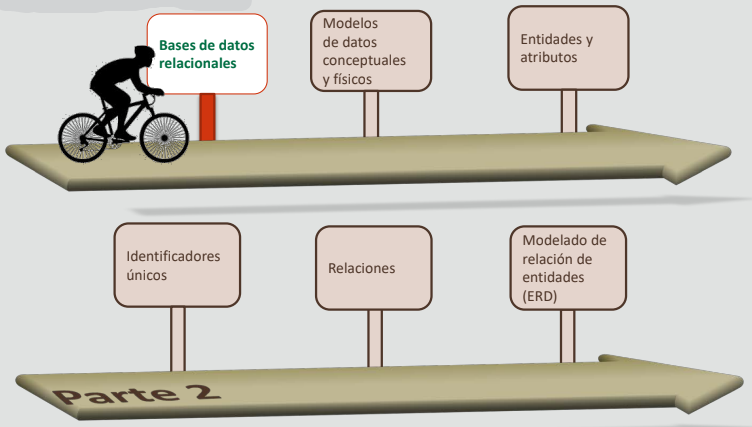
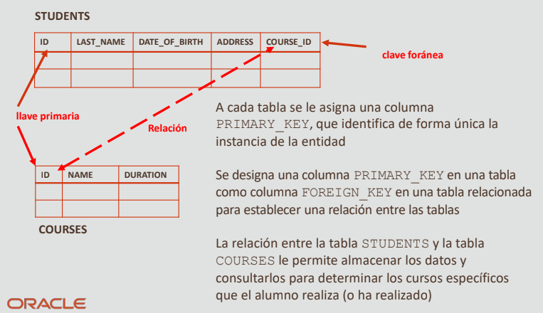
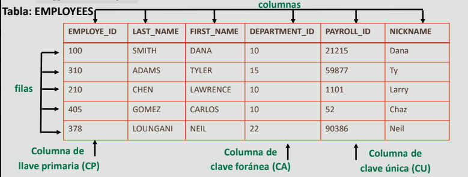

# 2.1 Bases de datos relacionales

## Hoja de ruta

## Objetivos
- En esta lección se abordan los siguientes objetivos:
    - Describir las funciones de una tabla única
    - Describir las funciones y reglas de una base de datos relacional
    - Describir las ventajas e inconvenientes de los tipos de bases de datos
    - Definir tablas relacionales y términos clave

### Tabla única
- Como se ha explicado anteriormente, una base de datos de archivos planos es un tipo de base de datos que almacena datos en una única tabla.
- Las bases de datos de archivos planos están normalmente en texto sin formato, en el que cada línea contiene solo un registro.

| |CUSTOMER_ID | FIRST_NAME | LAST_NAME | ADDRESS | CITY |
|-|------------|------------|-----------|---------|------|
| Record 1 | CN0001 | Rick | Carmen | King Street | Boston|
| Record 2 | CN0002 | Nick | Doris | 6 Rotrat | Boston |
| Record 3 | CN0003 | Mary | Pink | Centrale | Lagos |

#### Ventajas e inconvenientes de una base de datos de archivos planos

**Ventajas**
- Fácil de comprender
- Fácil de implantar
- Fácil de extraer información
- Todos los registros se almacenan en un solo lugar
- Ordenamiento y filtrado de informes simple
- Menos requisitos de hardware y software

**Inconvenientes**
- Menos seguridad
- Inconsistencia de datos
- Redundancia de datos
- Uso compartido de información laborioso
- Lentitud para bases de datos de gran tamaño

#### Ejemplo de base de datos de archivos planos

| | AUTHOR_ID | AUTHOR_NAME | TITLE |
|-|-----------|-------------|-------|
| Record 1 | AD0001 | Oscar Wilde | A Vision |
| Record 2 | AD0002 | Leo Tolstoy | War and Peace |
| Record 3 | AD0003 | Oliver Goldsmith | Citizen of the World |
| Record 4 | AD0003 | Oliver Goldsmith | Androcles and the Lion |

Tenga en cuenta que tanto los detalles del libro como los del autor se almacenan en esta tabla única y que los valores se repiten.

## Bases de datos relacionales

- Una base de datos relacional presenta la información en tablas con filas y columnas.
- Cada columna representa un tipo concreto de información (un campo) y cada fila muestra un registro.
- A continuación, las tablas se relacionan entre sí mediante un campo común.
- Se utiliza un campo único, denominado clave, para identificar cada registro de una base de datos relacional.

### Base de datos relacional: Ejemplo

#### Ventajas de una base de datos relacional (varias tablas)
- Menos redundancia
- Prevención de inconsistencias
- Eficacia
- Integridad de los datos
- Confidencialidad

**Tablas relacionales**
- Una tabla es una estructura simple donde se organizan y se almacenan los datos.

> Nota: Hablaremos de los tipos de clave que se muestran aquí más adelante en la lección y en el curso.

#### Reglas para tablas de bases de datos relacionales
- Cada tabla tiene un nombre distinto.
- Cada tabla puede contener varias filas.
- Cada tabla tiene un valor para identificar de forma única las filas.
- Cada columna de una tabla tiene un nombre único.
- Las entradas en las columnas son valores únicos.
- Las entradas en las columnas son del mismo tipo.
- El orden de las filas y las columnas no es importante.

### Términos clave
- **Tabla**: Estructura de almacenamiento básica.
- **Columna**: Atributo que describe la información de la tabla.
- **Llave primaria**: Identificador único para cada fila.
- **Clave foránea**: Columna que hace referencia a una columna de llave primaria en otra tabla.
- **Fila**: Datos de una instancia de tabla.
- **Campo**: El único valor que se encuentra en la intersección de una fila y una columna.

