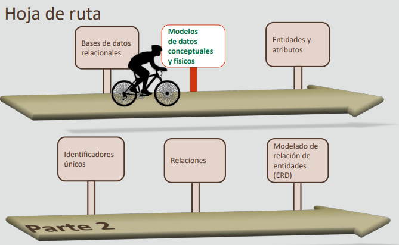
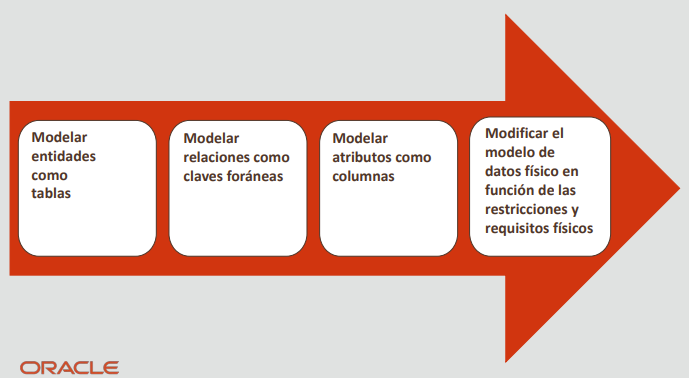
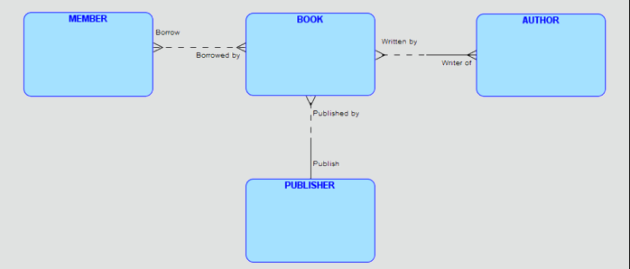
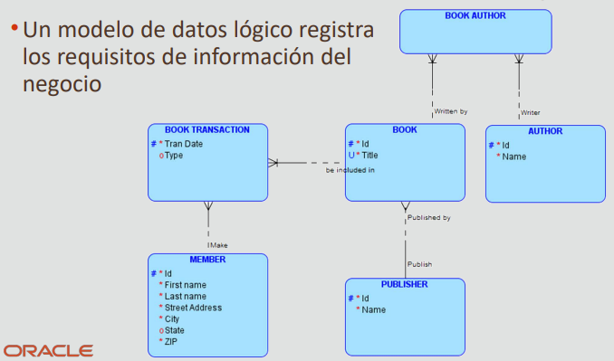
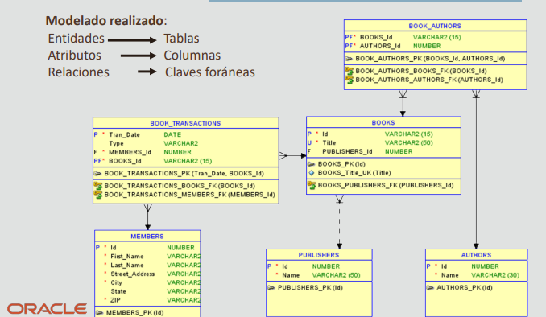

# 2.2 Modelos de datos conceptuales y físicos

## Hoja de ruta

## Objetivos
En esta lección se abordan los siguientes objetivos:
- Describir un modelo de datos conceptual
- Describir un modelo de datos lógico
- Describir un modelo de datos físico
- Analizar las similitudes y diferencias entre los modelos de datos conceptuales y físicos

## ¿Qué es un modelo conceptual?
- Captura las necesidades funcionales y de información de un negocio.
- Se basa en las necesidades actuales, pero puede reflejar las necesidades futuras
- Aborda las necesidades de un negocio (lo ideal desde el punto de vista conceptual), pero no su implantación (lo físicamente posible)
- Identifica:
    - Entidades importantes (objetos que se convierten en tablas en la base de datos)
    - Relaciones entre entidades
- No especifica:
    - Atributos (objetos que se convierten en columnas o campos en la base de datos)
    - Identificadores únicos (un atributo que se convierte en llave primaria en la base de datos)

## ¿Qué es un modelo lógico?
- Incluye todas las entidades y relaciones entre sí
- Se denomina modelo de relación de entidades (ERM)
- Se ilustra en un ERD
- Especifica todos los atributos y UID para cada entidad
- Determina la opcionalidad del atributo
- Determina la opcionalidad y la cardinalidad de la relación

## ¿Qué es un modelo físico?
- Es una extensión de un modelo de datos lógico
    - Especifica las definiciones de tabla, los tipos de dato y la precisión
    - Identifica las vistas, los índices y otros objetos de base de datos
- Describe cómo se deben implantar los objetos en una base de datos específica
- Muestra todas las estructuras de tabla, incluidas las columnas, llaves primarias y claves foráneas

**Pasos para crear un modelo de datos físico**

**Modelos conceptuales y físicos**
- El arte de la planificación, el desarrollo y la comunicación produce un resultado deseado
- El modelado de datos es el proceso de captura de los conceptos y reglas importantes que forman un negocio, y su representación visual en un diagrama
- Este diagrama se convierte en el plan detallado para diseñar el elemento físico
- El sueño del cliente (modelo conceptual) se convierte en una realidad física (modelo físico)

## Escenarios de caso

### Modelo lógico/conceptual
- **Pedido de profesor**:
    - Matt, me gustaría que crearas una base de datos de biblioteca simplificada para almacenar los detalles de los libros de nuestro departamento.
- **Matt**:
    - Claro. Empezaré por identificar las entidades, los atributos y sus relaciones

**Creación de un modelo conceptual**
- Un modelo de datos conceptual registra entidades importantes y cómo se relacionan entre sí

**Creación de un modelo lógico**

- Un modelo de datos lógico describe los datos con tantos detalles como sea posible, sin tener en cuenta
cómo se implantará físicamente en la base de datos. Normalmente se deriva de un modelo de datos
conceptual

### Modelo físico
- **Pedido de profesor**:
    - Matt, quiero ver las especificaciones de todas las tablas y columnas necesarias en la base de datos de biblioteca simplificada
- **Matt**:
    - Claro. Convertiré las entidades y sus atributos en tablas y columnas

**Creación de un modelo físico**
- El modelado físico se ocupa de la conversión del modelo de datos lógico en un modelo de base de datos
relacional. Cada modelo relacional puede tener uno o más modelos físicos, uno para cada RDBMS en el que
despliegue. 

## Resumen
- En esta lección, debe haber aprendido a hacer lo siguiente:
    - Describir un modelo conceptual
    - Describir un modelo lógico
    - Describir un modelo físico
    - Analizar las similitudes y diferencias entre los modelos de datos conceptuales y físicos

