# 2.3 Entidades y atributos

## Objetivos
- En esta lección se abordan los siguientes objetivos:
    - Identificar entidades
    - Identificar atributos
    - Identificar atributos obligatorios, opcionales, volátiles y no volátiles
    - Describir las notaciones Barker, Bachman y de ingeniería de la información

## Entidad
- Información de la que se debe realizar un seguimiento
- Nombre de cosas que puede mostrar en una lista (normalmente en forma de sustantivo)

**Ejemplo**:
La gerente del hotel del distrito, Sharon Ferguson, desea gestionar la información que guarda su compañía sobre sus hoteles, huéspedes y habitaciones. Sharon es responsable de varios hoteles en distintas ubicaciones. Quiere saber qué habitaciones tiene en cada hotel y el precio de cada una. También desea saber qué habitaciones ha reservado un huésped para una fecha determinada.

**Tipos de entidad**
- Una entidad se puede clasificar como uno de los siguientes tipos:

|Nombre | Descripción | Ejemplo |
|-------|-------------|---------|
|Principal| Existe de forma independiente| CUSTOMER, INSTRUCTOR|
|Característica| Existe gracias a otra entidad (principal)| ORDER, CLASS OFFERING|
|Intersección | Existe gracias a dos o más entidades| ORDER ITEM, CLASS ENROLLMENT

**Entidades e instancias**
- Las entidades contienen instancias
- Una instancia de entidad es una única incidencia de una entidad
- Las entidades representan un juego de instancias que son de interés para un negocio concreto

**Ejercicio 1 del proyecto**
- Base de datos de la tienda Oracle Baseball League Identificación de entidades.

## Base de datos de la tienda Oracle Baseball League
Identificación de entidades

## Atributos
- Los atributos describen entidades y son la información específica que se debe conocer
- Se trata de los detalles de una propiedad de un solo valor de una entidad

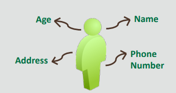

**Características de los atributos**
- Los atributos se muestran en el cuadro de entidad del ERD
- Los nombres de atributo aparecen en singular y en minúsculas, o mayúsculas y minúsculas
- En la mayoría de los casos, el nombre del atributo no debe incluir el nombre de la entidad, porque los atributos se cualifican con el nombre de la entidad.
- Los atributos se clasifican de las siguientes formas:
    - Obligatorios (no se permiten valores nulos), indicados con un *
    - Opcionales (se permiten valores nulos), indicados con una "o" en minúscula.

**Atributos volátiles y no volátiles**
- Los atributos volátiles son atributos inestables.
    - Ejemplo: Age
- Los atributos no volátiles son atributos estables.
    - Ejemplo: Birth Date

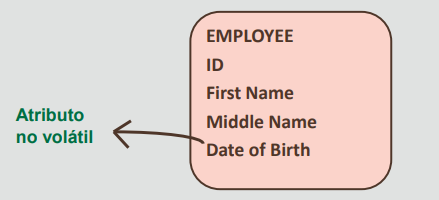

**Ejercicio 2 del proyecto**
- Base de datos de la tienda Oracle Baseball League
- Identificación de atributos

**Atributos obligatorios y opcionales**
- Los atributos obligatorios deben tener un valor
- Los atributos opcionales pueden no tener un valor y pueden estar en blanco (valor nulo)

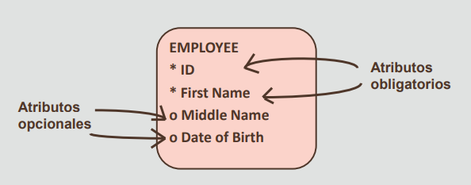

**Atributos únicos y compuestos**
- Los atributos únicos o atómicos son los atributos que no se pueden dividir en subpartes
- Los atributos compuestos son los atributos que se pueden dividir en subpartes más pequeñas que representan atributos básicos con diferentes significados propios

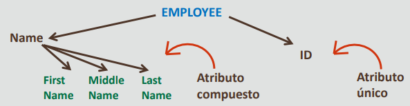

**Atributos de un único valor y de varios valores**
- Los atributos de un único valor pueden tener un solo valor en un momento concreto
    - Ejemplo: Student Last Name
- Los atributos de varios valores pueden tener más de un valor al mismo tiempo
    - Ejemplo: Address

**Ejercicio 3 del proyecto**
- Base de datos de la tienda Oracle Baseball League Identificación de atributos obligatorios/opcionales

## Notación de Barker

**Reglas para representar las entidades**
- Una entidad se representa mediante un rectángulo con las esquinas redondeadas
- La entidad debe tener un nombre y el nombre se debe colocar dentro de la entidad en la esquina superior izquierda
- El nombre de la entidad debe estar en mayúsculas
- El nombre de la entidad debe estar en singula

**Reglas para representar los atributos**
- Los atributos se deben escribir para que todos los usuarios, y no solo los desarrolladores, puedan comprenderlos
- Los atributos se deben escribir con la primera letra de cada palabra en mayúsculas y el resto en minúsculas
- Junto a cada atributo se debe colocar un símbolo que representa el tipo de atributo (* si es obligatorio u opcional, y # si es un UID)

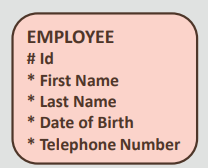

**Reglas para representar relaciones**
- Una relación puede existir como máximo entre dos entidades
- Puede existir una relación en la misma entidad (recursiva)
- Una relación tiene dos perspectivas
- Ambas perspectivas de una relación se deben etiquetar

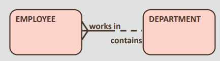

## Notación de Bachman
- Entidad (representada con un cuadro)
- Atributos
- Líneas de relación

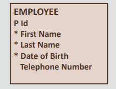

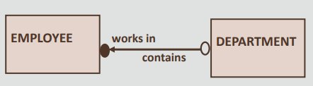

La notación de Bachman también es un modelo binario.
- Atributos:
    - Se muestra * para indicar que no es nulo y que no hay ninguna notación de atributos nulos.
    - Se muestra P para el UID y F para el atributo creado a través de la relación.
- Líneas de relación:
    - Se muestra una flecha en lugar de una pata de gallo para la cardinalidad máxima.
    - Se muestra un círculo abierto o un círculo relleno en lugar de una línea discontinua y una líne sólida para la cardinalidad mínima.

La relación se representa como una línea que conecta las entidades asociadas. A la relación se le asigna una frase que describe la asociación en ambos extremos de la línea.

En la notación de Bachman, una subclase se representa como un cuadro interno dentro de la superclase. 

## Notación de ingeniería de información
La notación de ingeniería de información también es un método binario. Es sencillo y fácil de leer, y se
ajusta perfectamente a la lógica de alto nivel y al modelado de datos de la empresa.

No permite una relación ternaria y no muestra los atributos relacionados con una relación. Las
restricciones tanto de cardinalidad como de participación se combinan en la notación de mínimo/máximo
(barra y pata de gallo).

La única desventaja de esta notación es que no soporta la identificación de atributos de una entidad. 

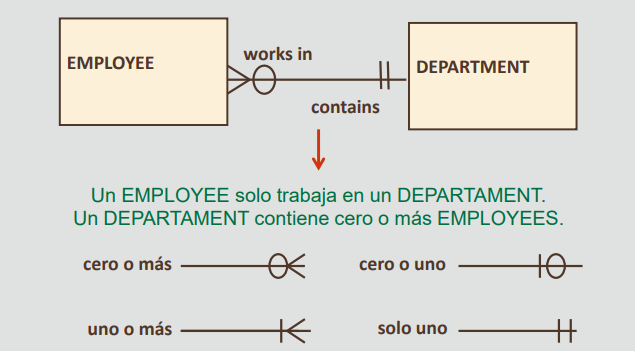

## Notaciones del modelo de datos
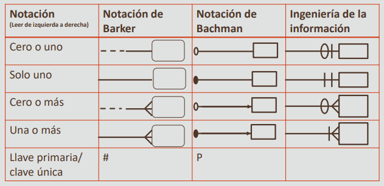

**Ejemplos**

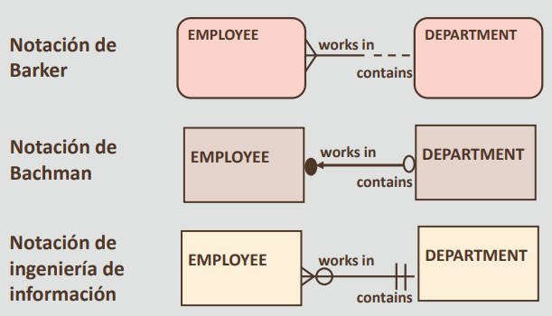

**Ejercicio 4 del proyecto**
−Base de datos de la tienda Oracle Baseball League
−Uso de la notación de Barker

## Resumen
- En esta lección, debe haber aprendido a hacer lo siguiente:
    - Identificar entidades
    - Identificar atributos
    - Identificar atributos obligatorios, opcionales, volátiles y no volátiles
    - Describir las notaciones Barker, Bachman y de ingeniería de la información

