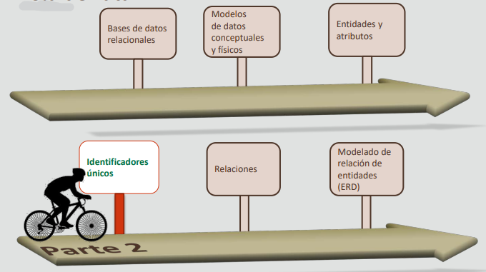
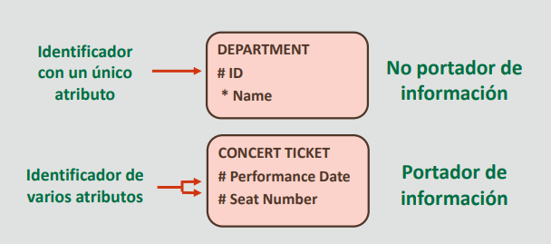
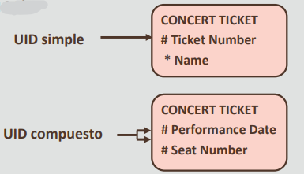
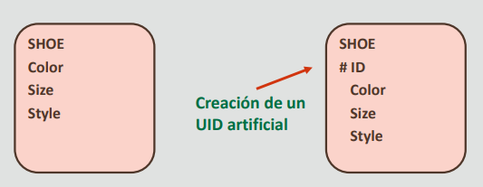
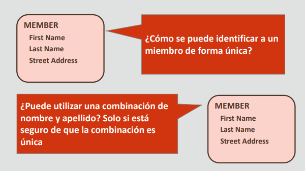
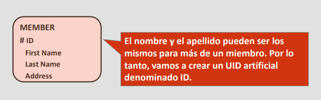
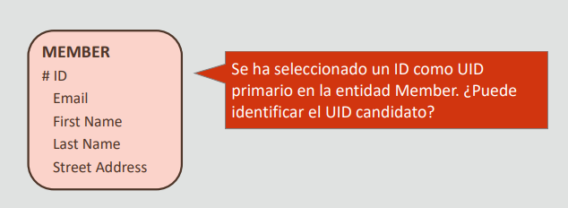
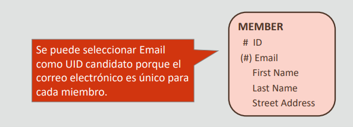
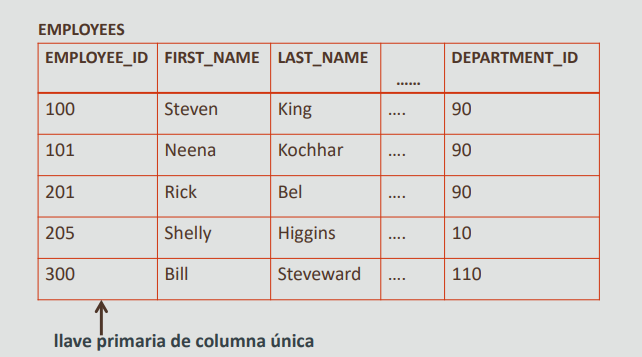
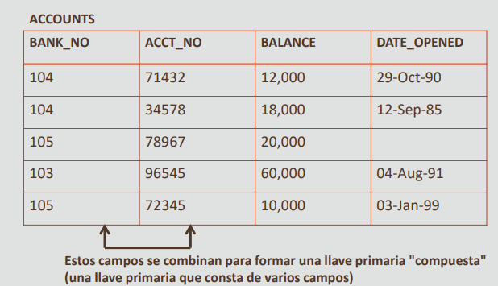

# 2.4 Identificadores únicos

## Hoja de ruta

## Objetivos
- En esta lección se abordan los siguientes objetivos:
    - Identificar los identificadores únicos (UID)
    - Identificar los identificadores únicos artificiales
    - Identificar los identificadores únicos compuestos
    - Identificar los identificadores únicos secundarios y candidatos
    - Definir llaves primarias

## Identificadores únicos
- Un identificador único es un atributo de una entidad que cumple las siguientes reglas:
    - Es único en todas las instancias de la entidad
    - Tiene un valor no NULL para cada instancia de la entidad en el tiempo que dura la instancia
    - Tiene un valor que nunca cambia en el tiempo que dura la instancia

- Un UID es un atributo especial o un grupo de atributos que identifica de forma única una instancia concreta de una entidad

**Ejemplos**
- Cada entidad debe tener un identificador único.
- De lo contrario, no es una entidad.

El UID puede ser portador de información cuando sus valores tienen algún significado de negocio. Un UID no portador de información en ocasiones se conoce como una clave artificial. Un UID portador de
información en ocasiones se conoce como una clave natural.

## UID simples frente a UID compuestos
- Un UID que es un solo atributo es un UID simple.
- En algunas ocasiones, un único atributo no es suficiente para identificar de forma única una instancia de una entidad
- Si el UID es una combinación de atributos, se denomina UID compuesto

**Ejercicio 1 del proyecto**
- Base de datos de la tienda Oracle Baseball League Identificación de identificadores únicos (UID)

## Identificador único artificial
- Un UID artificial se crea a partir de datos que asigna o genera el sistema
- Los UID artificiales no se producen de forma natural, pero se crean con fines de identificación en un sistema

**Ejercicio 2 del proyecto**
- Base de datos de la tienda Oracle Baseball League Identificación de identificadores únicos artificiales

## Escenario de caso

### Identificadores únicos candidatos
- Una entidad puede tener más de un UID
- UID candidatos:
    - Número de tarjeta de identificación
- Número de nómina
- Solo se puede elegir uno de los UID candidatos como UID primario
- Los demás candidatos se denominan UID secundarios

## Llave primaria
- Un UID se convierte en una llave primaria cuando el modelo lógico se transforma en una base de datos
física
- La llave primaria (CP) es una columna o un juego de columnas que identifica de forma única cada fila de
una tabla
- No puede contener valores nulos
- La llave primaria es una columna existente de la tabla ouna generada específicamente por la base de datos según una secuencia definida 
- Debe contener un valor único para cada fila de datos

**Llave primaria: Ejemplo**

**Llave primaria compuesta: Ejemplo**

## Resumen
- En esta lección, debe haber aprendido a hacer lo siguiente:
    - Identificar los identificadores únicos (UID)
    - Identificar los identificadores únicos artificiales
    - Identificar los identificadores únicos compuestos
    - Identificar los identificadores únicos secundarios y candidatos
    - Definir llaves primarias

