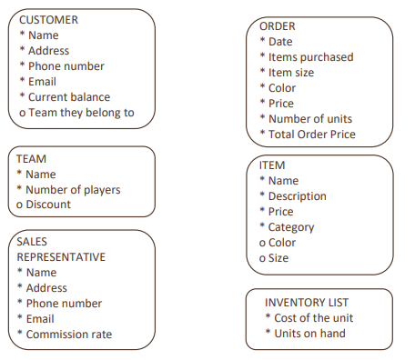
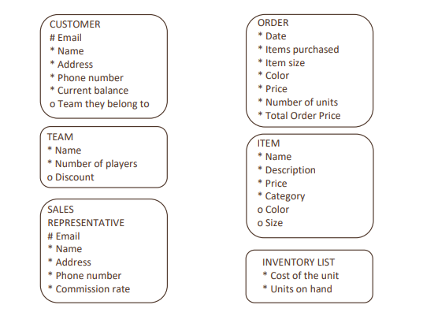

# Proyecto de diseño de base de datos
## Base de datos de la tienda Oracle Baseball League

**Escenario del proyecto**:

Usted es una pequeña empresa de consultoría especializada en el desarrollo de bases de datos. Le acaban de adjudicar un contrato para desarrollar un modelo de datos para un sistema de aplicaciones de bases de datos de una pequeña tienda denominada Oracle Baseball League (OBL).

La tienda ofrece servicios de venta de conjuntos de béisbol para toda la comunidad. OBL tiene dos tipos de cliente; hay personas que pueden adquirir artículos como pelotas, zapatillas, guantes, camisas, camisetas serigrafiadas y pantalones. Además, los clientes pueden representar a un equipo cuando adquieren uniformes y equipación conjunta.

Los equipos y los clientes individuales son libres de comprar cualquier artículo de la lista de inventario, pero los equipos obtienen un descuento en el precio de lista según el número de jugadores. Cuando un cliente realiza un pedido, registramos los artículos de ese pedido en nuestra base de datos.

El equipo de OBL cuenta con tres representantes de ventas que oficialmente solo atienden a equipos, pero se sabe que gestionan las quejas de los clientes individuales. 

### Ejercicio 1: Identificadores únicos
**Reconocimiento de identificadores únicos o UID (objetivo 1 de S2L4)**

Mediante los softboxes de notación de Barker, creados en el ejercicio anterior, identifique las posibles claves de candidatos (atributos que pueden usarse para identificar una entidad de forma exclusiva) que haya en las entidades.

- Si puede identificar todos los UID portadores de información (natural), agregue un signo # para indicar la opcionalidad del atributo y desplácelo a la parte superior de la lista de atributos.
- Si hay más de un atributo (compuesto) que combinados convierten la entidad en única, agregue un signo # antes de cada nombre de atributo y desplace todos ellos a la parte superior de la lista.

**Posible entidades y atributos**

### Ejercicio 2: Identificadores únicos
**Reconocimiento de identificadores únicos artificiales (objetivo 2 de S2L4)**

Mediante los softboxes de notación de Barker creados anteriormente, identifique y asigne los identificadores únicos que se utilizarán para identificar de forma exclusiva las entidades.
- Si no se ha asignado ningún identificador portador de información, asigne uno artificial Normalmente, utilizamos el ID o número como nombre del identificador artificial.
- Si se ha reconocido un identificador portador de información, deberá elegir si lo va a utilizar como identificador único primario o secundario. Si va a utilizarlo como un identificador secundario, deberá crear un identificador artificial e incluir el signo # del identificador portador de información entre paréntesis.

**Posible entidades y atributos**

