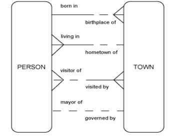
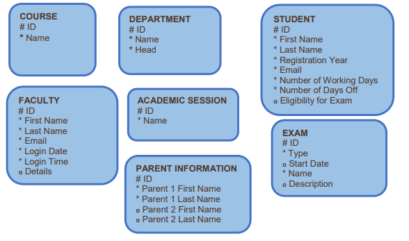

# Fundamentos de bases de datos
## 2-5: Relaciones
### Prácticas

**Ejercicio 1: Identificar las relaciones del ERD**

**Visión general**
En esta práctica, identificará las relaciones a partir de los diagramas ERD y escribirá las sentencias en lenguaje ERD.

### Tareas
1. Interprete la relación. ¿Se corresponde el texto con el diagrama?

- Cada EMPLOYEE se puede asignar a uno o más DEPARTMENTs. Cada DEPARTMENT debe responsabilizarse de uno o más EMPLOYEEs.
- Cada EMPLOYEE se debe asignar a un único DEPARTMENT. Cada DEPARTMENT debe responsabilizarse de uno o más EMPLOYEEs.
- Cada EMPLOYEE se debe asignar exactamente a un DEPARTMENT. Cada DEPARTMENT puede ser responsable exactamente de un EMPLOYEE.

2. Interprete cada relación del modelo que aparece a continuación. Para cada relación de ERD, escriba la sentencia ERD y sus comentarios. Utilice sus conocimientos sobre personas y ciudades normales en sus comentarios.

**Ejercicio 2: Analizar y modelar relaciones**

**Visión general**

En esta práctica, analizará y modelará las relaciones para las siguientes entidades que ha creado anteriormente en la base de datos
académica.

### Tareas
1. Escriba en lenguaje ERD cada una de las relaciones de la base de datos académica, incluyendo los nombres de relación, la opcionalidad y la cardinalidad. Dibuje el ERD incluyendo las relaciones.

