# Proyecto de diseño de base de datos
## Base de datos de la tienda Oracle Baseball League

**Escenario del proyecto:**

Usted es una pequeña empresa de consultoría especializada en el desarrollo de bases de datos. Le acaban de adjudicar un contrato para desarrollar un modelo de datos para un sistema de aplicaciones de bases de datos de una pequeña tienda denominada Oracle Baseball League (OBL).

La tienda ofrece servicios de venta de conjuntos de béisbol para toda la comunidad. OBL tiene dos tipos de cliente; hay personas que pueden adquirir artículos como pelotas, zapatillas, guantes, camisas, camisetas serigrafiadas y pantalones. Además, los clientes pueden representar a un equipo cuando adquieren uniformes y equipación conjunta.

Los equipos y los clientes individuales son libres de comprar cualquier artículo de la lista de inventario, pero los equipos obtienen un descuento en el precio de lista según el número de jugadores. Cuando un cliente realiza un pedido,registramos los artículos de ese pedido en nuestra base de datos.

El equipo de OBL cuenta con tres representantes de ventas que oficialmente solo atienden a equipos, pero se sabe que gestionan las quejas de los clientes individuales.

### Ejercicio 1: Relaciones
Reconocer ejemplos de relaciones (objetivo 1 de S2L5)
Las relaciones representan una asociación entre dos o más entidades. Mediante las reglas de negocio, identificadas anteriormente en este proyecto y enumeradas a continuación, identifique las posibles asociaciones entre las entidades.

**Reglas de negocio**
- Los clientes pueden ser individuales o representar un equipo.
- Los clientes pueden adquirir artículos de la lista de inventario.
- Los equipos obtienen descuentos en función del número de jugadores.
- Las compras de los clientes se almacenan como pedidos en la base de datos.
- Los representantes de ventas trabajan principalmente con clientes de equipos, pero también pueden tratar con clientes individuales.

**Posible entidades y atributos**

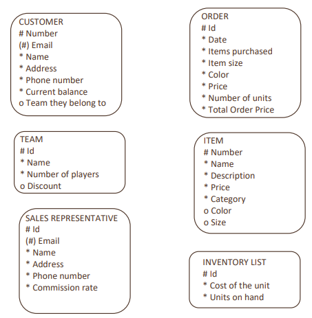

### Ejercicio 2: Relaciones
Identificar la opcionalidad de las relaciones (objetivo 2 de S2L5)
Las relaciones son bidireccionales y deben ser obligatorias u opcionales. 

**Parte 1**:

Para las relaciones identificadas en el ejercicio anterior, escriba la opcionalidad de la relación entre ambas entidades (recuerde que la relación existe en ambas direcciones); ya se ha completado la primera.

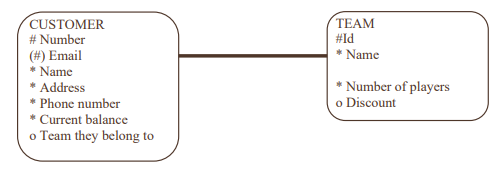

De izquierda a derecha
- Cada CUSTOMER puede representar a un TEAM. 

De derecha a izquierda
- Cada TEAM debe estar representado por un CUSTOMER.

 

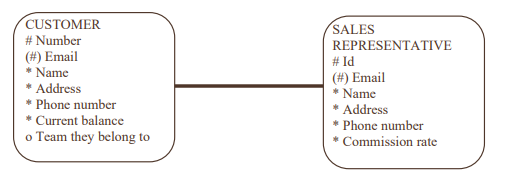

De izquierda a derecha
- 

De derecha a izquierda
- 

 

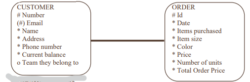

De izquierda a derecha
- 

De derecha a izquierda
- 

 

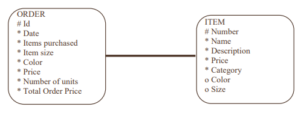

De izquierda a derecha
- 

De derecha a izquierda
- 

 

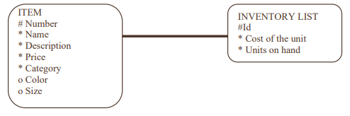

De izquierda a derecha
- 
De derecha a izquierda
- 

**Parte 2:**

Las líneas de relación representan una relación bidireccional entre dos entidades; por lo tanto, debe considerarlas dos líneas independientes que se originan en su entidad y se cruzan en el medio. Mediante las descripciones que anotó en la parte 1, complete las líneas de relación para que representen la opcionalidad de cada relación; ya se ha completado la primera.

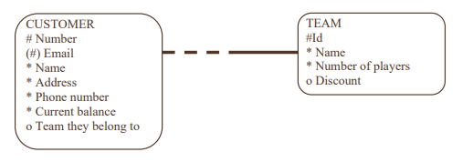

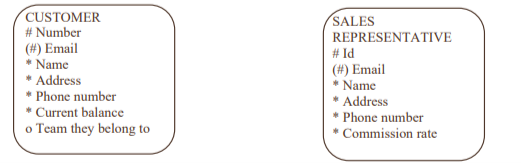

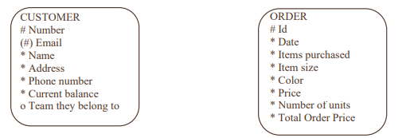

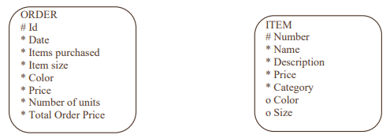

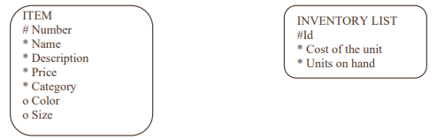

## Ejercicio 3: Relaciones

**Identificar la cardinalidad de las relaciones (objetivo 3 de S2L5)**

Para las relaciones identificadas en el ejercicio anterior, determine la cardinalidad mediante el análisis de la descripción proporcionada para cada relación. Si la descripción utiliza "un" o "una", debería ser una relación de 1 (punta única); sin embargo, si utiliza "varios" o "uno o más", debería ser una relación M (pata de gallo). Agregue la cardinalidad a las siguientes entidades agregando cualquier notación de pata de gallo necesaria.

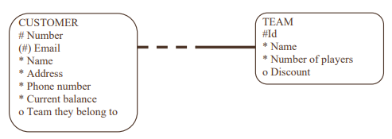

- Cada CUSTOMER puede representar a un TEAM.
- Cada TEAM debe estar representado por un CUSTOMER.

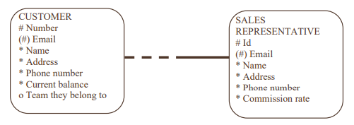

- Cada CUSTOMER se puede asignar a un SALES REPRESENTATIVE.
- Cada SALES REPRESENTATIVE debe asignarse a una o más entidades CUSTOMER.

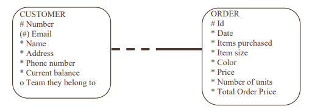

- Cada CUSTOMER debe realizar una o más entidades ORDER.
- Cada ORDER debe realizarlo un CUSTOMER.

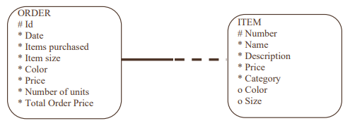

- Cada ORDER debe incluir una o más entidades ITEM.
- Cada ITEM puede ser parte de una o más entidades ORDER.

- Cada ITEM debe estar en una INVENTORY LIST.
- Cada INVENTORY LIST puede incluir una o más entidades ITEM.

## Ejercicio 4: Relaciones
Uso de una matriz de relaciones (objetivo 5 de S2L5)
Una matriz de relaciones muestra si cada entidad de fila de la parte izquierda de la matriz se relaciona con cada entidad
de columna que se muestra en la parte superior de la matriz y cómo lo hacen.
- Si una entidad de fila se relaciona con una entidad de columna, el nombre de esa relación se muestra en el cuadro de intersección.
- Si una entidad de fila no se relaciona con una entidad de columna, el cuadro de intersección está vacío.
- Las relaciones recursivas se pueden representar colocando el nombre de dicha relación en la diagonal.

**Parte 1:**

Cree una matriz de relaciones para validar las relaciones que ya ha identificado a lo largo de este proyecto. Utilice las
descripciones de las entidades para crear los nombres de la relación en el cuadro de intersección.

**Parte 2**:

Utilice los nombres que ha agregado a los cuadros de intersección de la matriz de relaciones para agregar las etiquetas
correctas a las relaciones correspondientes de los ERD.

