# 2.5 Relaciones

## Hoja de ruta

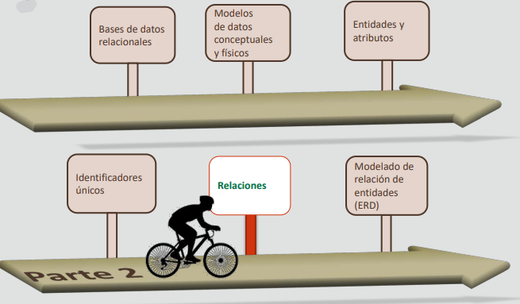

## Objetivos
- En esta lección se abordan los siguientes objetivos:
    - Definir y reconocer ejemplos de relaciones y las correspondientes clave foránea
    - Identificar la opcionalidad de las relaciones
    - Identificar la cardinalidad de las relaciones
    - Tipos de relaciones
    - Matriz de relaciones

## Relaciones
- Una relación es una asociación bidireccional y significativa entre dos entidades o entre una entidad y ella misma

- Las relaciones representan una asociación entre dos o más entidades
- La línea de relación del diagrama puede ser sólida (obligatoria) o discontinua (opcional)
- Estas líneas terminan en una "única punta" (una instancia) o una "pata de gallo" (una o más instancias)

- Las relaciones tienen nombres que ayudan a describir la conexión entre las entidades
- En el diagrama de relaciones, el nombre de la relación, desde cualquier perspectiva, se imprime cerca del punto de inicio de la línea de relación

- Ejemplos:
    - DEPARTMENTs contains EMPLOYEEs
    - EMPLOYEEs assigned to DEPARTMENTs

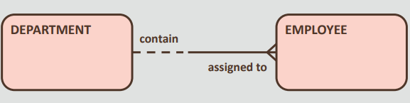

### Clave Foránea
- Las relaciones en un modelo de datos conceptual se asignan a claves foráneas en una tabla de base de datos física
- Una clave foránea (CF) es una columna o una combinación de columnas de una tabla que hace
referencia a una llave primaria en la misma tabla o en otra tabla

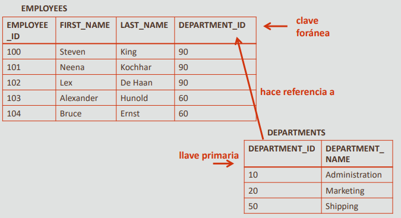

### Componentes de una relación
Los componentes de la relación incluyen
lo siguiente:
- Nombre: Etiqueta que aparece junto a la entidad a la que está asignada. Asegúrese de que todos los nombres de relación estén en minúsculas
- Cardinalidad: Número mínimo y máximo de los valores de la relación
    - Un único registro coincidente
    - Uno o más registros coincidentes
- Opcionalidad: Si la relación debe existir
    - Opcional (cero registros coincidentes)
    - Obligatorio (al menos un registro coincidente en cada entidad)

- Al leer la sentencia de la regla de negocio, utilice el
siguiente texto:
    - Opcional: Utilice "puede ser" o "puede"
    - Obligatoria: Utilice "debe ser" o "debe"
    - Línea: Utilice "único"
    - Pata de gallo: Utilice "uno o más"
- La sintaxis de la regla de negocio es la siguiente:
    - Cada entidad1 {debe ser o puede ser} nombre de relación {uno o más o único} entidad2

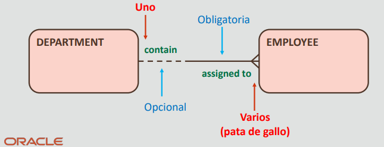

**Ejercicio 1 del proyecto**
- Base de datos de la tienda Oracle Baseball League
- Reconocer ejemplos de relaciones

### ¿En qué consiste la opcionalidad en una relación?
- Las relaciones son obligatorias u opcionales
- Pongamos el ejemplo de las dos entidades, EMPLOYEE y JOB
- En función de la información que tenga sobre las instancias de las entidades, puede determinar la opcionalidad respondiendo a dos preguntas:
    - ¿Debe tener cada empleado un trabajo? Es decir, ¿es una relación obligatoria u opcional para un empleado?
    - ¿Cada trabajo debe ser realizado por un empleado? Es decir, ¿es una relación obligatoria u opcional para un trabajo?

**Ejercicio 2 del proyecto**
- Base de datos de la tienda Oracle Baseball League
- Identificar la opcionalidad de las relaciones

### ¿En qué consiste la cardinalidad en una relación?
- La cardinalidad mide la cantidad de algo
- En una relación, determina el grado de relación de una entidad con otra respondiendo a la pregunta "¿Cuántos?"
- Por ejemplo:
- ¿Cuántos trabajos puede tener un empleado? ¿Solo un trabajo? ¿O más de un trabajo?
- ¿Cuántos empleados pueden tener un trabajo específico? ¿Un solo empleado? ¿O más de un empleado?

**Determinación de la cardinalidad mínima de la relación**

- ¿Cuál es la cardinalidad mínima en cada dirección?

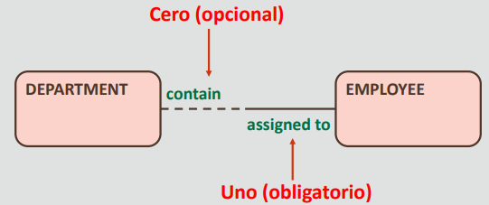

**Determinación de la cardinalidad máxima de la relación**

- ¿Cuál es la cardinalidad máxima en cada dirección?

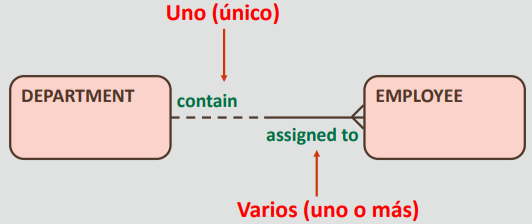

**Ejercicio 3 del proyecto**
- Base de datos de la tienda Oracle Baseball League
- Identificar la cardinalidad de las relaciones

### Opcionalidad y cardinalidad: Ejemplos
- Cada EMPLOYEE debe tener un único JOB
- Cada JOB puede realizarlo uno o más EMPLOYEE
- Cada PRODUCT debe clasificarse por un único PRODUCT TYPE
- Cada PRODUCT TYPE puede clasificar uno o más PRODUCTs

**Tipos de relaciones**
- Todas las relaciones representan los requisitos de información y las reglas del negocio
    - De varios a uno (M:1) o de uno a varios (1:M)
    - De varios a varios (M:M)
    - De uno a uno (1:1)

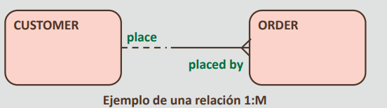

**Relaciones de varios a uno y de uno a varios**
- Las relaciones de varios a uno y de uno a varios (M:1 y 1:M) tienen la cardinalidad de uno o más en una dirección y de solo uno en la dirección contraria

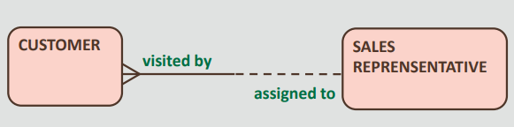

- Reglas de negocio:
    - Cada CUSTOMER debe recibir la visita de un único SALES REPRESENTATIVE
    - Cada SALES REPRESENTATIVE puede asignarse a uno o más CUSTOMER

**Relaciones de varios a varios**
- Las relaciones de varios a varios (M:M) tienen la cardinalidad de uno o más en ambas direcciones

- Reglas de negocio:
    - Cada EMPLOYEE puede asignarse a uno o más JOB
    - Cada JOB puede realizarlo uno o más EMPLOYEE

**Relaciones de uno a uno**
- Las relaciones de uno a uno (1:1) tienen la cardinalidad
de solo uno en ambas direcciones

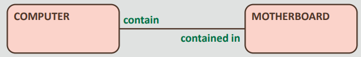

- Reglas de negocio:
    - Cada COMPUTER debe contener una única MOTHERBOARD
    - Cada MOTHERBOARD debe contenerla un único COMPUTER

**Relaciones recursivas**
- Una relación recursiva es una relación con una entidad y ella misma

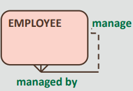

- Reglas de negocio:
    - Cada EMPLOYEE puede gestionar uno o más EMPLOYEE
    - Cada EMPLOYEE debe ser gestionado por un único EMPLOYEE

### Matriz de relaciones: Recopilación de Información
Una matriz de relaciones se puede utilizar para recopilar información inicial acerca de las relaciones entre un juego de entidades

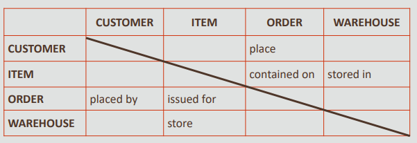

Una matriz de relaciones tiene las siguientes
características:
- Una matriz de relaciones muestra si cada entidad de fila de la parte izquierda de la matriz se relaciona con cada entidad de columna que se muestra en la parte superior de la matriz y cómo lo hacen
- Todas las entidades se muestran en la parte izquierda y superior de la matriz
- Si una entidad de fila se relaciona con una entidad de columna, el nombre de esa relación se muestra en el cuadro de intersección
- Si una entidad de fila no se relaciona con una entidad de columna, el cuadro de intersección está vacío
- Cada relación por encima de la línea diagonal es la imagen inversa o duplicada de una relación por debajo de la línea
- Las relaciones recursivas se representan con los cuadros en la
diagonal

**Asignación de contenidos**
Asigne los contenidos de la matriz de relaciones a un ERD

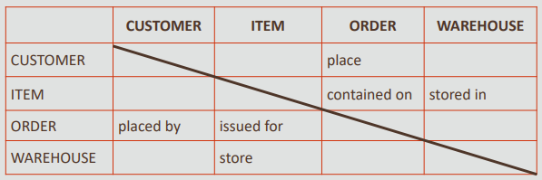

- Resultados de la asignación de los contenidos de la matriz de relaciones a un ERD:

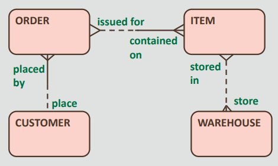

## Determinación de la existencia de una relación
- Examine cada par de entidades para determinar si existe una relación

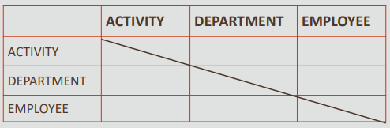

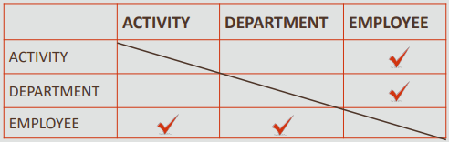

- Asigne un nombre a cada dirección de una relación

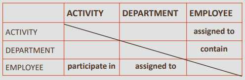

**Ejercicio 4 del proyecto**
- Base de datos de la tienda Oracle Baseball League
- Uso de una matriz de relaciones

## Resumen
- En esta lección, debe haber aprendido lo siguiente:
    - Definir y reconocer ejemplos de relaciones y las correspondientes clave foránea
    - Identificar la opcionalidad de las relaciones
    - Identificar la cardinalidad de las relaciones
    - Tipos de relaciones
    - Matriz de relaciones

