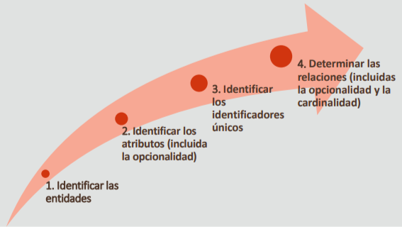
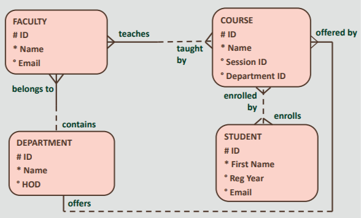
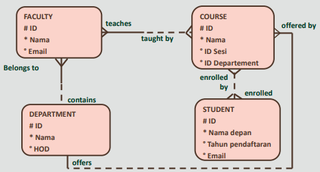
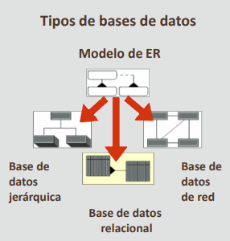
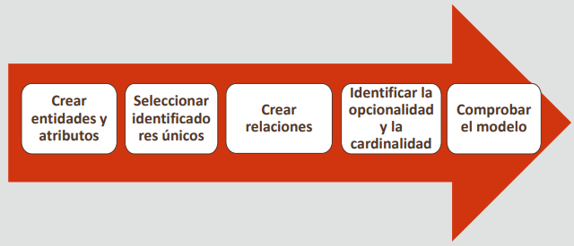
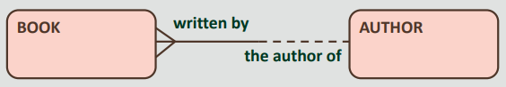
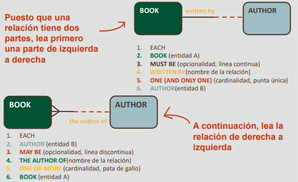
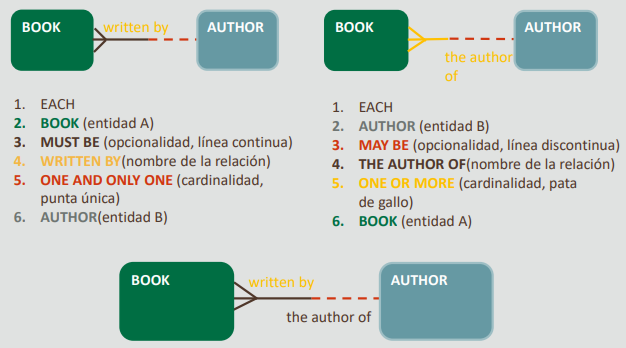
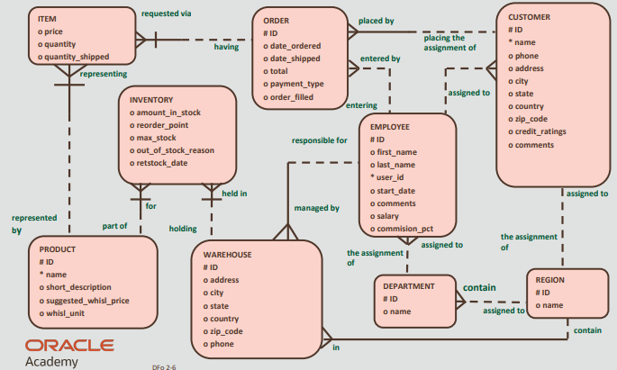

# 2.6 Modelado de relación de entidades (ERD)

## Objetivos
- En esta lección se abordan los siguientes objetivos:
    - Describir el modelado de datos
    - Explicar el término "sin implantación" cuando está relacionado con los modelos de datos y la implantación del diseño de base de datos
    - Enumerar los cuatro objetivos del modelado de relación de entidad
    - Identificar un diagrama de relación de entidad (ERD)
    - Asignar relaciones con ERDish
    - Crear componentes de ERD que representan entidades y atributos
    según las convenciones para la creación de diagramas

## Objetivo del modelado conceptual
- Cuando diseña una casa, lo que finalmente desea es ver la casa construida
- Incluso si no realiza la construcción real, necesita comprender los términos del constructor para ayudarle a convertir su diseño conceptual en una realidad física
- El modelo conceptual de base de datos se puede utilizar para discusiones posteriores más detalladas entre los diseñadores, administradores de base de
datos y desarrolladores de aplicaciones
- Un modelo conceptual es importante para un negocio porque:
    - Describe las necesidades exactas de información del negocio
    - Facilita la comunicación
    - Evita errores y malentendidos
    - Crea una base sólida para el diseño de la base de datos física
    - Documenta los procesos (también denominados reglas de negocio) del negocio
    - Tiene en cuenta las normativas y leyes vigentes en este sector

**Modelado conceptual**

- Un modelo conceptual es un modelo formal que:
    - Describe los elementos importantes para una organización (entidades)
    - Identifica las relaciones de nivel superior entre distintas entidades, pero puede o no incluir la cardinalidad y la nulidad
    - No especifica los atributos o el identificador único de cada entidad

## Modelado lógico

- El modelo de datos lógico:
    - Describe los datos con tantos detalles como sea posible, sin tener en cuenta cómo se implantarán físicamente en la base de datos
    - Normalmente se deriva de un modelo de datos conceptual.
    - Incluye todas las entidades, atributos, UID y relaciones, además de la opcionalidad y la cardinalidad de estos elementos
-  El modelo lógico se ilustra con un ERD

**Pasos para crear un modelo lógico**

**Modelado lógico: Ejemplo**

## Diagrama de relación de entidad (ERD)
- Un ERD es un modelo que identifica los conceptos o las entidades que existen en un sistema y las relaciones entre esas entidades
- Tiene diferentes objetivos:
    - El analista/diseñador de la base de datos puede comprender mejor la información que se va a incluir en la base de datos a través del proceso de construcción del ERD
    - Funciona como herramienta de documentación
    - Se utiliza para comunicar la estructura lógica de la base de datos a los usuarios. En concreto, comunica de forma efectiva la lógica de la base de datos a los usuarios
- Un ERD se puede utilizar para representar los requisitos de
los datos de un negocio, independientemente del tipo de base de datos que se utilice e incluso si no hay ninguna
- Una representación gráfica de entidades y las relaciones entre sí

## Modelos sin implantación

- Un buen modelo de datos lógico sigue siendo el mismo independientemente del tipo de sistema de base de datos que finalmente se incorpore o implante
- Esto es lo que seentiende por modelo "sin implantación"

## Modelo de relación de entidad (ERM)
- Se deriva de las especificaciones de negocio y su objetivo consiste en crear una imagen clara de la información que se almacena en una futura base de datos
- Se trata de una lista de todas las entidades y atributos, así como todas las relaciones entre las entidades que son importantes
- Proporciona información en segundo plano como, por ejemplo, descripciones de las entidades, tipos de dato y restricciones
- No necesita un diagrama, pero el diagrama suele ser una herramienta muy útil

## Objetivos del modelado de ERD
- Capturar toda la información necesaria
- Asegurarse de que la información solo aparece una vez
- No modelar ninguna información derivada de otra información que ya esté modelada
- Localizar información en un lugar previsible y lógico

**Pasos para crear un ERD**

**Creación de sentencias ERDish para representar los ERD**
- ERDish es el término que se utiliza para comunicar con claridad las reglas de negocio capturadas en un ERD
- Utilice el lenguaje ERDish para indicar las relaciones entre entidades en un ERD
- Solo tiene que desglosar cada sentencia ERDish en sus componentes

**Componentes de ERDish**

- EACH
- Entidad A
- OPTIONALITY (must be/may be)
- RELATIONSHIP NAME
- CARDINALITY (one and only one/ one or more)
- Entidad B

**Ejemplo de ERDish**

**Escenario de caso**

**Validación de la relación**
- Vuelva a examinar el ERD y valide la relación

- Cada BOOK solo debe estar escrito por un único AUTHOR
- Cada AUTHOR puede ser el autor de uno o varios BOOK

**Escenario de negocio de artículos deportivos**
- Nuestros dos clientes principales se encuentran en Estados Unidos: Big John's Sports Emporium en San Francisco, California, and Women's Sports en Seattle,
Washington
- Para cada cliente, se debe realizar el seguimiento de un ID y un nombre. También podemos realizar el seguimiento de una dirección (incluidos la ciudad, el estado, el código postal y el país) y un número de teléfono
- Mantenemos almacenes en distintas regiones para satisfacer los pedidos de nuestros clientes
- Para cada pedido, se debe realizar seguimiento de un ID. También podemos realizar un seguimiento de la fecha de pedido, la fecha de envío y el tipo de pago si la información está disponible. Nuestro personal de entrada de pedidos está muy familiarizado con nuestra línea de productos.
- Solemos tener reuniones con el equipo de marketing para obtener más información sobre los productos nuevos. El resultado es una mayor satisfacción del cliente porque podemos responder a sus preguntas.
- Tratamos con algunos clientes selectos y mantenemos una línea de productos especial. Para cada producto, debemos conocer el ID y el nombre. En ocasiones
también debemos conocer la descripción, el precio sugerido y la unidad de venta.
- Cuando sea necesario, también deseamos que se pueda realizar un seguimiento de descripciones largas e imágenes de nuestros productos.

**Ejercicio del proyecto**
- Base de datos de la tienda Oracle Baseball League:
- Modelado de relaciones de entidad

## Resumen
- En esta lección, debe haber aprendido lo siguiente:
    - Describir el modelado de datos
    - Explicar el término "sin implantación" cuando está relacionado con los modelos de datos y la implantación del diseño de base de datos
    - Enumerar los cuatro objetivos del modelado de relación de entidad
    - Identificar un ERD
    - Asignar relaciones con ERDish
    - Crear componentes de ERD que representan entidades y atributos
    según las convenciones para la creación de diagramas

 