# 3.1 Más sobre relaciones

## Hoja de ruta
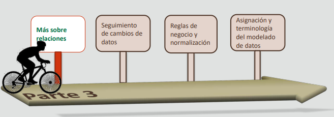

## Objetivos
- En esta lección se abordan los siguientes objetivos:
    - Identificar relaciones de bloqueo
    - Resolver relaciones M:M
    - Identificar e ilustrar relaciones no transferibles
    - Identificar y representar gráficamente las entidades de supertipo y subtipo
    - Identificar relaciones jerárquicas, recursivas y de arco

### Identificación de relaciones (de bloqueo)
- ¿Cuál es el UID de la entidad ACCOUNT?

- El UID requiere ACCOUNT Number y la relación entre
BANK y ACCOUNT

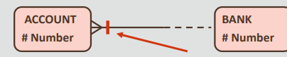

- El UID de la entidad ACCOUNT está compuesto por el
ACCOUNT Number y BANK Number. La barra de línea
de relación representa esta relación

- Una entidad se puede identificar únicamente a través
de varias relaciones

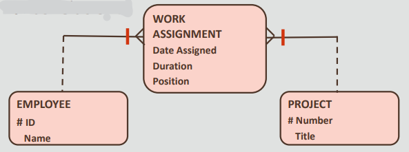

-  El UID de WORK ASSIGNMENT es EMPLOYEE ID y PROJECT Number (se representa mediante barras)

### Relaciones M:M
- Los atributos solo describen entidades
- Si los atributos describen una relación, la relación se debe resolver

**Resolución de relaciones M:M: Ejemplo 1**
- Resolución de una relación M:M con una nueva entidad de intersección y dos relaciones de bloqueo

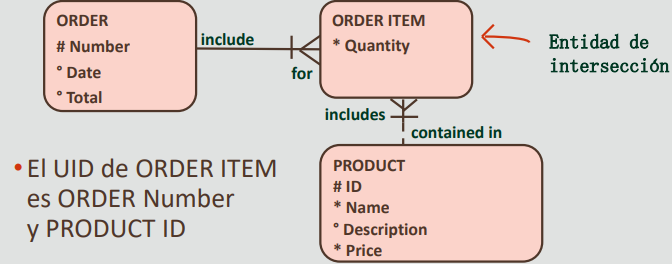

#### Características de un subtipo
- Un subtipo:
    - Hereda todos los atributos del supertipo
    - Hereda todas las relaciones del supertipo
    - Normalmente tiene sus propios atributos o relaciones
    - Se representa gráficamente dentro del supertipo
    - Nunca existe en solitario
    - Puede tener sus propios subtipos
    - Tiene claves primarias idénticas a las del supertipo y el subtipo

#### Escenario de caso: Resolución de relaciones M:M

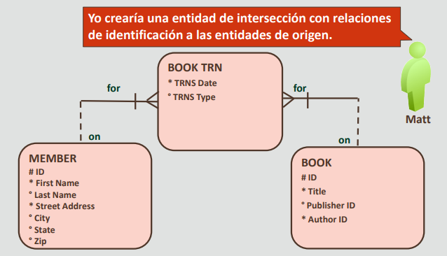

**Resolución de relaciones M:M: Ejemplo 2**
- Las entidades EMPLOYEE y JOB no almacenan el historial de trabajos de un empleado

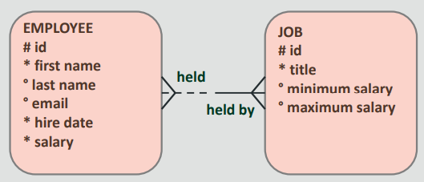

**Resolución de relaciones M:M mediante una entidad de intersección con relaciones de bloqueo**

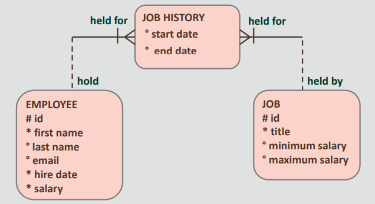

**Ejercicio 1 del proyecto**
- Base de datos de la tienda Oracle Baseball League
- Resolución de relaciones de varios a varios

### Relaciones no transferibles
- La "transferabilidad" es la capacidad que tiene una entidad de cambiar a lo largo del tiempo entre dos instancias
- Una relación no transferible no se puede transferir entre las instancias de las entidades que conecta
- Una relación no transferible se representa mediante un diamante en la relación

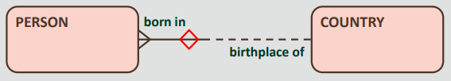

- Las relaciones no transferibles solo pueden ser obligatorias
- Por ejemplo, el país de nacimiento de una persona no es transferible

#### Escenario de caso

- La afiliación solo la puede retener una persona
- La relación de afiliación no puede transferirse a otra persona

**Ejercicio 2 del proyecto**
- Base de datos de la tienda Oracle Baseball
- League Identificación e ilustración de relaciones no transferibles

### Entidades Supertype y Subtype
- **Supertype** tiene una relación principal-secundario con uno o más subtipos
- **Subtype** será un subagrupamiento de la entidad en un tipo de entidad que tiene atributos que se diferencian de otros subagrupamientos

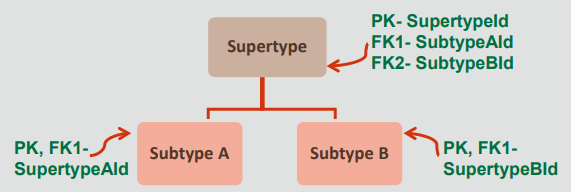

**Representación gráfica de un subtipo**

-  Cada subtipo es una especialización de un supertipo y, por lo tanto, debe
estar incluido dentro de una entidad
- Los atributos y relaciones comunes para todos los subtipos deben aparecer solo en el supertipo, pero se heredan en cada subtipo
- Un subtipo puede tener, y por lo general tendrá, sus propios atributos y relaciones
- No habrá nunca un subtipo únicamente; debe crearse otro subtipo que contenga
el resto

**Entidad supertipo y subtipo: Ejemplo**

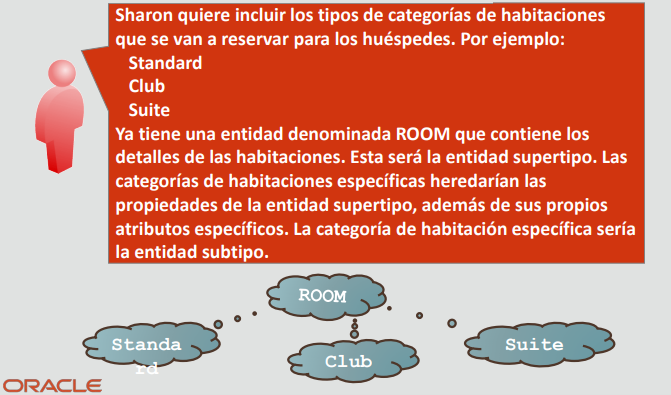

#### Generalización y especialización**
- La generalización es un enfoque ascendente donde dos o más entidades de nivel inferior se combinan para formar una entidad de nivel superior en función de las características comunes
-  La especialización es un enfoque descendente donde la entidad de nivel superior se desglosa en entidades de nivel inferior

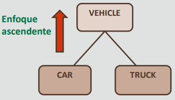 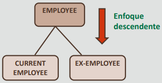

#### Reglas de subtipo de entidad
- Exhaustivas:
    - Cada instancia de un supertipo es también una instancia de uno de los subtipos
    - OTHER se debe incluir como subtipo para categorizar instancias que no están definidas por alguno de los subtipos existentes
    - Ejemplo: Un empleado debe estar a tiempo completo, a tiempo parcial u otra duración

- Mutuamente excluyentes:
    - Cada instancia del supertipo es de un solo un subtipo
    - Ejemplo: Un empleado no puede estar a la vez a tiempo completo y a tiempo parcial

**Identificación correcta de subtipos**
- ¿Es este subtipo una clase de supertipo?
- ¿He cubierto todos los casos posibles? (exhaustivas)
- ¿Se ajusta cada instancia solo a un único subtipo? (mutuamente excluyentes)

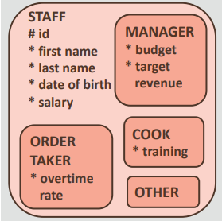

**Subtipos anidados**
- Puede anidar subtipos

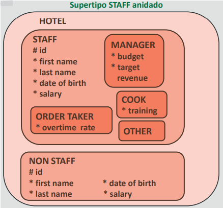

**Ejercicio 3 del proyecto**
- Base de datos de la tienda Oracle Baseball League
- Identificación y representación gráfica de entidades supertipo y subtipo

### Modelado de datos jerárquicos
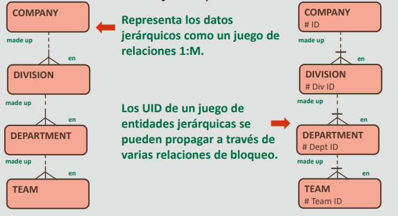

#### Relaciones recursivas
- Una relación recursiva es aquella en la que una instancia de entidad se relaciona con otra de la misma entidad
- Una relación recursiva se modela siempre con un bucle

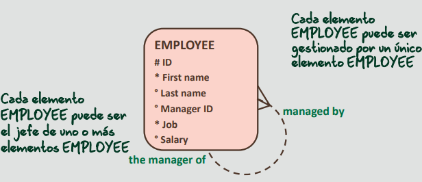

**Descripción de las relaciones recursivas**

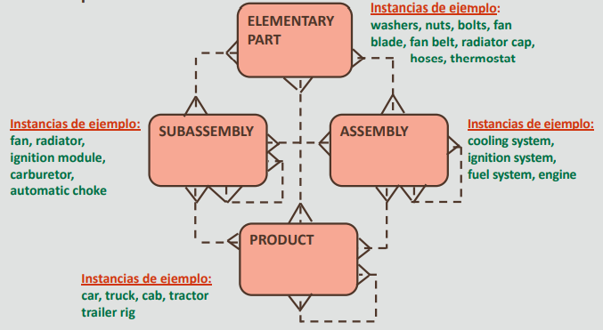

**Modelado genérico**
- Otra forma de modelar la relación recursiva de una lista de materiales consiste en crear una entidad COMPONENT genérica
- Así se crearía una relación M:M recursiva

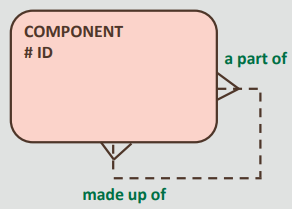

**Resolución de una relación recursiva M:M**
- Resuelva la relación recursiva M:M con una entidad de
intersección

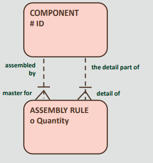

### Relación de arco
- Un arco es un grupo de relaciones exclusivas, que se define de forma que solo puede existir una de las relaciones para cualquier instancia de una entidad
- El arco que se traza entre dos relaciones las conecta y demuestra que se excluyen entre sí
- La relación implica una condición "or"
- El arco indica que cualquier instancia de esa entidad puede tener solo una relación válida de la relación en el arco en cualquier momento dado

**Características de una relación de arco**
- Las relaciones de un arco normalmente tienen el mismo nombre de relación
- Las relaciones de un arco deben ser o bien todas obligatorias o bien todas opcionales, además de tener la misma cardinalidad
- Un arco pertenece a una sola entidad y solo debe incluir las relaciones que se originen en la entidad
- La entidad puede tener varios arcos, pero una relación concreta solo puede participar en un único arco
- Una relación de arco se representa como una línea en forma de arco entre dos o más líneas de relación
- Las relaciones que se incluyen en el arco tienen un círculo en la línea de arco de relación
- Una entidad supertipo y sus subtipos se pueden modelar como una relación de arco
- Ejemplo: Una entidad EMPLOYEE es un elemento CURRENT EMPLOYEE o uno EX-EMPLOYEE,pero no
puede ser ambos (también se puede modelar como un supertipo/subtipo)

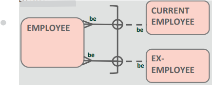

**Escenario de caso: Relación de arco**

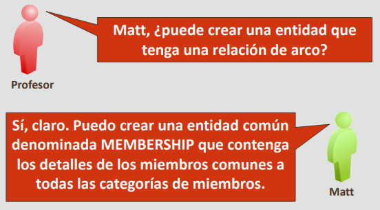

**Creación de una entidad común**

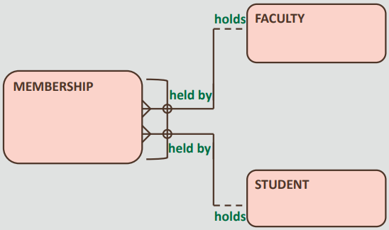

**Ejercicio 4 del proyecto**

- Base de datos de la tienda Oracle Baseball League Identificación de relaciones jerárquicas, recursivas y de arco

## Resumen
- En esta lección, debería haber aprendido a:
    - Identificar relaciones de bloqueo
    - Resolver relaciones M:M
    - Identificar e ilustrar relaciones no transferibles
    - Identificar y representar gráficamente las entidades de supertipo y subtipo
    - Identificar relaciones jerárquicas, recursivas y de arco

