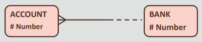
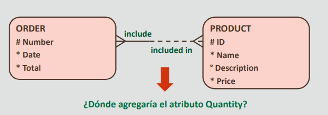
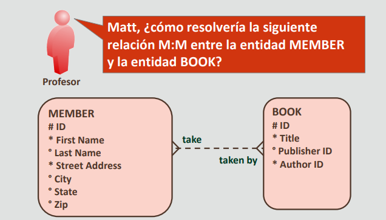
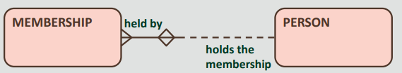
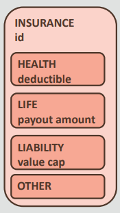

# 3.1 Más sobre relaciones

## Hoja de ruta

## Objetivos
- En esta lección se abordan los siguientes objetivos:
    - Identificar relaciones de bloqueo
    - Resolver relaciones M:M
    - Identificar e ilustrar relaciones no transferibles
    - Identificar y representar gráficamente las entidades de supertipo y subtipo
    - Identificar relaciones jerárquicas, recursivas y de arco

### Identificación de relaciones (de bloqueo)
- ¿Cuál es el UID de la entidad ACCOUNT?

- El UID requiere ACCOUNT Number y la relación entre
BANK y ACCOUNT

- El UID de la entidad ACCOUNT está compuesto por el
ACCOUNT Number y BANK Number. La barra de línea
de relación representa esta relación

- Una entidad se puede identificar únicamente a través
de varias relaciones

-  El UID de WORK ASSIGNMENT es EMPLOYEE ID y PROJECT Number (se representa mediante barras)

### Relaciones M:M
- Los atributos solo describen entidades
- Si los atributos describen una relación, la relación se debe resolver

**Resolución de relaciones M:M: Ejemplo 1**
- Resolución de una relación M:M con una nueva entidad de intersección y dos relaciones de bloqueo

#### Características de un subtipo
- Un subtipo:
    - Hereda todos los atributos del supertipo
    - Hereda todas las relaciones del supertipo
    - Normalmente tiene sus propios atributos o relaciones
    - Se representa gráficamente dentro del supertipo
    - Nunca existe en solitario
    - Puede tener sus propios subtipos
    - Tiene claves primarias idénticas a las del supertipo y el subtipo

#### Escenario de caso: Resolución de relaciones M:M

**Resolución de relaciones M:M: Ejemplo 2**
- Las entidades EMPLOYEE y JOB no almacenan el historial de trabajos de un empleado

**Resolución de relaciones M:M mediante una entidad de intersección con relaciones de bloqueo**

**Ejercicio 1 del proyecto**
- Base de datos de la tienda Oracle Baseball League
- Resolución de relaciones de varios a varios

### Relaciones no transferibles
- La "transferabilidad" es la capacidad que tiene una entidad de cambiar a lo largo del tiempo entre dos instancias
- Una relación no transferible no se puede transferir entre las instancias de las entidades que conecta
- Una relación no transferible se representa mediante un diamante en la relación

- Las relaciones no transferibles solo pueden ser obligatorias
- Por ejemplo, el país de nacimiento de una persona no es transferible

#### Escenario de caso

- La afiliación solo la puede retener una persona
- La relación de afiliación no puede transferirse a otra persona

**Ejercicio 2 del proyecto**
- Base de datos de la tienda Oracle Baseball
- League Identificación e ilustración de relaciones no transferibles

### Entidades Supertype y Subtype
- **Supertype** tiene una relación principal-secundario con uno o más subtipos
- **Subtype** será un subagrupamiento de la entidad en un tipo de entidad que tiene atributos que se diferencian de otros subagrupamientos

**Representación gráfica de un subtipo**

-  Cada subtipo es una especialización de un supertipo y, por lo tanto, debe
estar incluido dentro de una entidad
- Los atributos y relaciones comunes para todos los subtipos deben aparecer solo en el supertipo, pero se heredan en cada subtipo
- Un subtipo puede tener, y por lo general tendrá, sus propios atributos y relaciones
- No habrá nunca un subtipo únicamente; debe crearse otro subtipo que contenga
el resto

**Entidad supertipo y subtipo: Ejemplo**

### Generalización y especialización**

