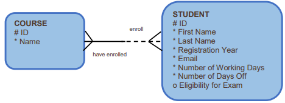
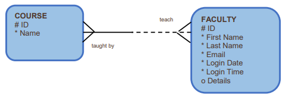
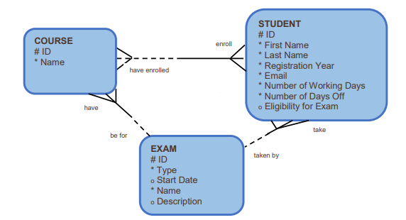

# Fundamentos de bases de datos
## 3-1: Más sobre relaciones
### Prácticas

**Ejercicio 1: Resolver relaciones M:M**

**Visión general**

En esta práctica, resolverá las siguientes relaciones M: M dentro de la base de datos académica. Agregue atributos adicionales en las entidades de intersección cuando sea necesario.

**Tareas**

1. Resuelva las relaciones M: M entre STUDENT y COURSE mediante una relación de bloqueo.

2. Resuelva las relaciones M: M entre FACULTY y COURSE

3. Resuelva relaciones M: M entre STUDENT,COURSE y EXAM. 

**Ejercicio 2: Adición de la opción de no transferibilidad para un ERD**

**Visión general**

En esta práctica, creará el ERD a partir de un escenario especificado y le agregará la opción de no transferibilidad.

**Tareas**

1. Se asignará un STUDENT a un EXAM RESULT tras realizar un examen. Una vez que se ha recibido un EXAM RESULT, no se
puede transferir a otro STUDENT.

**Ejercicio 3: Identificar y representar las entidades supertipo y subtipo**

**Tareas**

1. El profesorado puede serlo a tiempo completo o parcial. El profesorado a tiempo completo recibirá un salario y tiene derecho a un
plan de seguro. El profesorado a tiempo parcial cobra por horas y no recibe beneficios. Vuelva a dibujar la siguiente entidad como
un supertipo con entidades subtipo que reflejen la nueva información.

**Ejercicio 4: Examinar las relaciones exclusivas (arcos)**
**Tareas**

1. Determine cómo se deben modelar las relaciones exclusivas en el siguiente escenario.
Cada instancia de COURSE en la base de datos académica puede llevarse a cabo ONLINE o en una ubicación SEATED. Cada
ubicación SEATED tiene un nombre de edificio, un número de sala y una fecha/hora en la que se ofrece el curso (COURSE). Las
clases ONLINE tienen un ID de inicio de sesión y una contraseña necesarios para abrir el curso. Modele la nueva información
como arco en la base de datos académica.

**Ejercicio 5: Modelar datos jerárquicos**

**Tareas**

1. En esta práctica, modelará las entidades, las relaciones, los atributos y los identificadores únicos de la jerarquía de un hotel. El
hotel tiene varias plantas, varias suites en cada planta y varias habitaciones en cada suite.

**Ejercicio 6: Modelar datos jerárquicos y relaciones recursivas**

**Tareas**

1. Desarrolle dos ERD para representar la siguiente situación. Desarrolle uno como una estructura jerárquica y otro como una estructura recursiva.

Curves Dynamics vende productos en Estados Unidos. Se divide en cuatro regiones de ventas principales: las regiones Northern,
Eastern, Southern y Western. Cada región de ventas tiene un código de región único. Cada región de ventas se divide en cuatro
distritos de ventas. Por ejemplo, la región Western se divide en los distritos Rocky Mountain, Northwest, Pacific Coast y Pacific.
Cada distrito tiene un código de distrito único.

Cada distrito está formado por territorios de ventas. El distrito de Rocky Mountain se compone de tres territorios: WyomingMontana, Colorado y Utah-New Mexico. El distrito Northwest está formado por dos territorios: Washington y Oregon-Idaho. El
distrito Pacific Coast está formado por dos territorios: California y Nevada. El distrito Pacific incluye el territorio Hawaii y Alaska.
Cada territorio tiene un código de territorio único.

Cada territorio de ventas está dividido en áreas de ventas. Por ejemplo, Colorado está formado por dos áreas de ventas: Front
Range y Western Slope. Cada área de ventas tiene un código de área único.

Cada vendedor es responsable de una o varias áreas de ventas y tiene cuotas de ventas específicas. Cada gestor de ventas es
responsable de uno o varios distritos de ventas y directores de ventas, que son responsables de una o varias regiones de ventas.

Cada gestor de ventas es responsable de los territorios de sus distritos. Las responsabilidades de los empleados no se
superponen. Un área de ventas es siempre responsabilidad de un único vendedor, y las responsabilidades de gestores y
directivos no se superponen. En ocasiones, los vendedores, gestores y directores están de baja o tienen funciones especiales y
no tendrán responsabilidades del área de ventas. Todo el personal de ventas se identifica mediante ID de empleado.

**Ejercicio 7: Desarrollo de un ERD completo mediante un supertipo/subtipos y arcos**

**Tareas**

1. Desarrolle un ERD para los siguientes requisitos de información:

Right-Way Rental Truck Company alquila pequeños camiones de mudanzas y remolques para uso local y unidireccional. Hay 347 oficinas de alquiler en el oeste de Estados Unidos. El inventario de alquiler incluye un total de 5750 vehículos, que incluyen distintos tipos de camiones y remolques. Los datos de los que se debe realizar un seguimiento son los acuerdos de alquiler y las asignaciones de vehículos. Cada oficina de alquiler alquila los vehículos que tiene en inventario a los clientes que están preparados para tomar posesión del vehículo. No se realizan reservas y no se realiza ningún seguimiento de cuándo se espera
que el cliente devuelva el vehículo alquilado. La oficina central supervisa la distribución de vehículos y controla las transferencias
de vehículos de una oficina de alquiler a otra.

Cada oficina de alquiler tiene un nombre de oficina como "Madison Right-Way" y una dirección. Cada oficina tiene también un número de oficina de tres dígitos único. Cada oficina es la sede de algunos vehículos, y cada vehículo depende de una sola sede. Cada vehículo posee un ID de vehículo, un estado de registro y un número de registro de matrícula. Hay cinco tipos diferentes de vehículos: Camiones de 36 pies, camiones de 24 pies, camiones de 10 pies, remolques cubiertos de 8 pies y remolques abiertos de 6 pies, cada uno con un código de tipo. Se debe realizar un seguimiento de la última fecha de mantenimiento y la fecha de
caducidad del registro de todos los vehículos. Además, en el caso de los camiones, se debe almacenar la lectura del cuentakilómetros actual, la capacidad del depósito de gasolina y si tiene o no una radio operativa. Para desplazamientos largos,
los clientes realmente prefieren una radio. El kilometraje actual se registra antes del alquiler del camión y posteriormente, de
nuevo, cuando se entrega. Además, para los remolques se debe registrar la capacidad máxima de carga.

La mayoría de los acuerdos de alquiler son para clientes individuales, pero un acuerdo de alquiler puede ser tanto para un individuo como para una compañía. Un pequeño porcentaje de los camiones se alquila a compañías. A cada compañía se le asigna un número de compañía y se realiza un seguimiento del nombre y la dirección de la compañía. El grupo de ventas
corporativas gestiona toda la información por separado.

Para cada cliente individual, se realiza un seguimiento de la siguiente información: nombre, teléfono particular, dirección, y estado, número y fecha de caducidad del carné de conducir del conductor. Si un cliente daña un vehículo, lo abandona, o bien no paga
completamente la factura, el cliente se etiqueta como riesgo deficiente y no podrá volver a alquilar.

Solo una persona o una compañía puede obtener un contrato de alquiler, y se redacta un contrato de alquiler independiente para
cada vehículo. Los clientes pueden alquilar dos o más vehículos al mismo tiempo. Cada contrato de alquiler se identifica mediante
el número de la oficina de alquiler de origen y un número de contrato de alquiler. Además, se realiza un seguimiento de la fecha
de alquiler, la duración prevista del alquiler, la oficina de alquiler de origen, la oficina de alquiler de entrega del vehículo, el importe
del depósito pagado, la tasa de alquiler por día acordada y la tarifa por milla acordada. Para los remolques, no hay ningún cargo
por kilometraje.

